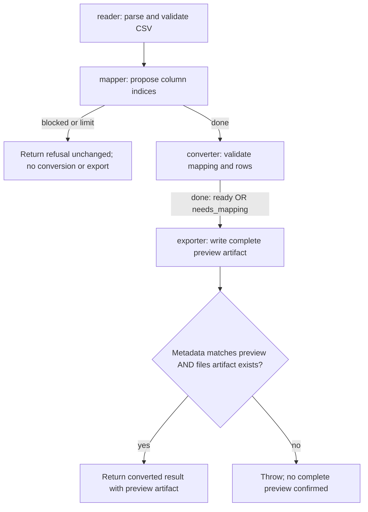

# Contact import: configured code route

Source interpretation, not an observed Run. This project currently selects the code mapper, not the mixed or Agent mapper.

The code mapper recognizes exactly three expected headings in any order. Otherwise it returns done with mapping:null.
The converter turns missing or invalid mappings into done with status:needs_mapping and empty accepted/rejected lists.
The current coordinator still exports that preview. A needs_mapping status does not currently stop export.
For valid mappings, rows are checked individually. Rejected rows do not by themselves prevent export.
The example previews contacts. It does not import them into a database.

## Source and folded behavior

- `jig.ts` and `bindings/code.ts` select the code route.
- `flows/import/method.ts` owns sequence, refusal propagation, export validation, and artifact forwarding.
- `flows/map-code/method.ts` owns recognized headings and null mapping.
- `flows/convert/method.ts` owns mapping checks and individual row validation.
- `flows/export-preview/method.ts` owns preview file creation.
- Unexpected reader, mapper, converter, or exporter outcomes throw. Export may already have written files before a later validation failure.
- CSV parsing, channel/report rendering, cancellation, exact schemas, and per-row validation details are folded into their source files.
