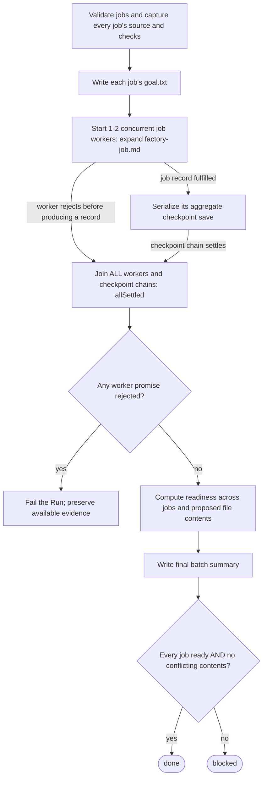

# Software factory: application behavior

Experimental source interpretation at `41fdef49`. This is a maintainer-authored interpretation, not generated CLI output or an execution trace.
The author is the coordinating coding agent. Reference checks do not verify the behavioral interpretation.

The factory prepares all jobs, starts them concurrently, and saves their results through a serialized checkpoint chain.
It joins every worker before deciding the batch outcome. A worker includes its checkpoint chain.

- A fulfilled job record can describe a failed, unrouted, or settled job. It does not establish an accepted repair.
- Checkpoint saves serialize. Job execution remains concurrent. The final decision follows the join, not each checkpoint.
- Different proposed contents for the same path conflict. Identical contents for the same path do not block readiness by themselves.
- Goal files precede routing. Validated repair deliverables and checkpoints can precede a later batch failure or blocked result.
- Accepted patches are checked separately. The application does not test them as one combined change or apply them.

Expand [one job](factory-job.md) for routing, its timer, returned-evidence validation, and delivery.
Expand [repair](factory-repair.md) for baseline checks, Agent proposals, feedback, and stopping conditions.

## Named omissions and failure boundaries

- Input parsing and file-capture internals are folded into A1. Invalid preparation stops before workers start.
- Root cancellation can stop the application across stages. It is separate from one job's routing-and-repair timer.
- A checkpoint failure can reject a worker chain. The join still waits for the other workers before propagating failure.
- Goal-file and final-summary writes can throw. Writes already completed are not shown as rolled back.
- Report rendering and channel forwarding details are folded. One-job forwarding failures are covered by the job scope.
- Native Agent internals, process cleanup, and root deadline enforcement are outside this application-source interpretation.

## Source anchors

Paths are relative to `examples/software-factory/`. Ranges identify evidence to read, not proof of the stated interpretation.

| Nodes / claim | Source |
|---|---|
| A1 | `flows/factory/batch.ts:112-127`; `flows/factory/files.ts:31-108`; `flows/factory/checks.ts:16-79` |
| A2 | `flows/factory/batch.ts:135-143` |
| A3 | `flows/factory/batch.ts:295-421` |
| A4 | `flows/factory/batch.ts:422-476` |
| A5-A7 | `flows/factory/batch.ts:478-507` |
| A8-A12 | `flows/factory/batch.ts:509-540` |
| Identical overlap versus conflict | `flows/factory/batch.ts:95-105` |

Source freshness is checked by the behavioral study packet. Reference checks do not verify behavior.
