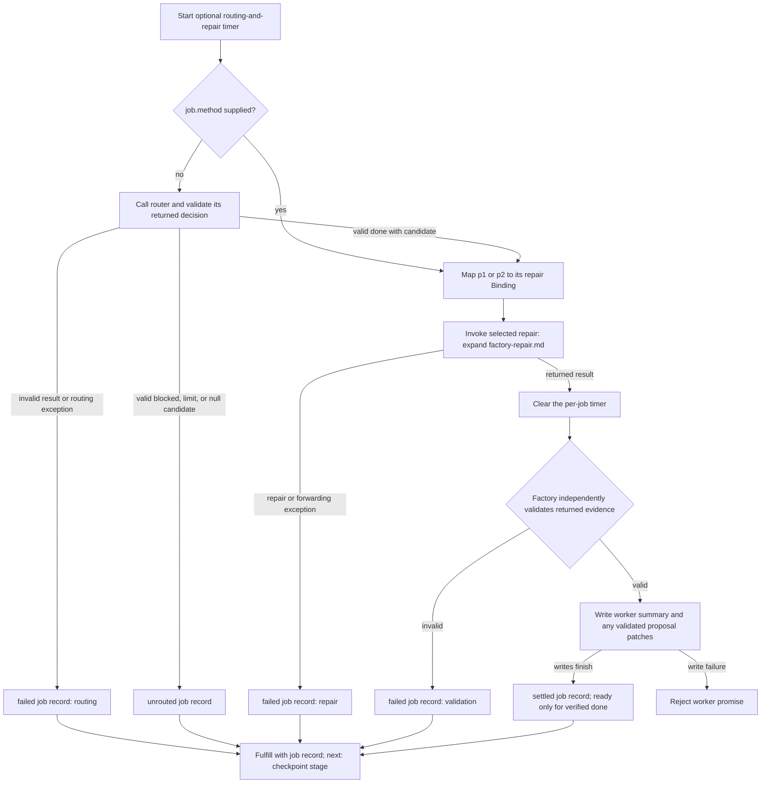

# Software factory: one job

Experimental source interpretation. Read [the application scope](factory-behavior.md) for concurrency, checkpoints, and batch outcomes.
Node B14 returns a job record to the application's checkpoint stage. Node B15 rejects the worker promise instead.

- `p1` selects `binding:single-pass`, with `maxProposals=1`.
- `p2` selects `binding:checked-correction`, with `maxProposals=2`.
- The timer is shared across routing and repair, including progress forwarding. It is not reset between those stages.
- Every exit from the routing-and-repair try block clears that timer. B9 shows its normal returned-result exit explicitly.
- The timer does not cover B10's evidence check or B12's file writes. Root cancellation and the root deadline remain separate.
- A per-job abort can produce a failed job record. Root cancellation is rethrown and can reject the worker promise.
- A valid `blocked` or `limit` repair can produce a summary and proposal files. Only a verified ready result produces `review.patch`.
- Goal files already exist before B1. Invalid router results and invalid worker evidence do not imply no files exist.

## Named omissions and source anchors

The source validates the selected method and checks cancellation before dispatch. Those checks are folded into B6-B7.
Their failures become job failures unless root cancellation is rethrown.
The two repair call sites are alternatives selected by progress-channel availability. They are grouped here through source interpretation.
Channel setup, forwarding, and closing are folded into B7. Operational write failures can leave partial output.

| Nodes / claim | Source, relative to `examples/software-factory/` |
|---|---|
| B1-B2; shared timer and cleanup | `flows/factory/batch.ts:295-321,349-370` |
| B3-B5 | `flows/factory/batch.ts:323-344`; `flows/router/decision.ts:57-79` |
| B6; method settings | `flows/factory/batch.ts:346-355`; `flows/factory/methods.ts:2-19`; `bindings/single-pass.ts:3-10`; `bindings/checked-correction.ts:3-10` |
| B7; alternative call sites | `flows/factory/batch.ts:194-294` |
| B4, B8; error conversion | `flows/factory/batch.ts:356-370` |
| B9-B11 | `flows/factory/batch.ts:368-384`; `flows/factory/files.ts:138-244` |
| B12-B13 | `flows/factory/batch.ts:385-420`; `flows/factory/files.ts:245-258` |
| B14-B15; checkpoint continuation | `flows/factory/batch.ts:398-480` |

Reference and source-identity checks do not establish semantic correctness. The study retains its audit and source basis separately.
