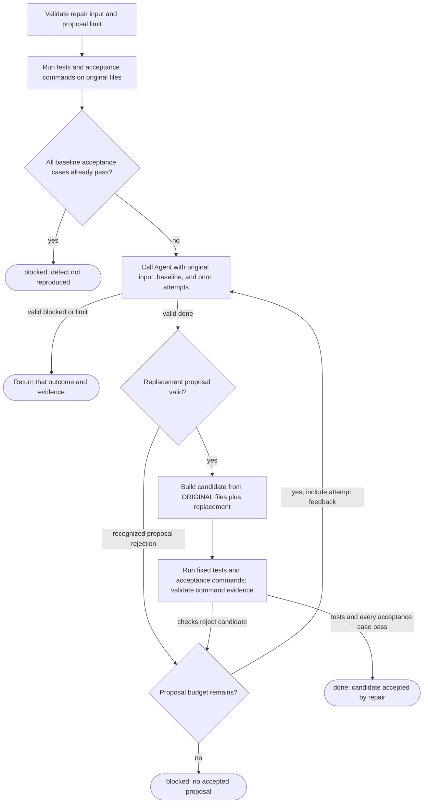

# Software factory: repair loop

Experimental source interpretation. This scope returns to the factory's independent evidence check, not directly to a successful batch result.

- The baseline stop gate checks acceptance cases, not the repository test verdict alone.
- Each proposal is applied to the original files. Correction does not silently accumulate the preceding candidate's changes.
- The selected Binding permits at most one or two repair Agent calls. Routing may use an additional Agent call outside this scope.
- Proposal rejection consumes a proposal attempt. A valid Agent `blocked` or `limit` response ends the repair immediately.
- `done` here still faces the factory's evidence gate. For example, the factory rejects completion without a nonempty accepted patch.

## Named omissions and source anchors

Invalid Agent envelopes, unexpected outcomes, invalid command evidence, unexpected exceptions, and cancellation propagate as errors.
These are not ordinary failed checks and are not shown entering the correction loop.
Progress publication, result formatting, and channel closing are folded. They can affect error propagation.
Agent internals are opaque. The call count above concerns the repair's `agent` slot, not model turns or native processes.

| Nodes / claim | Source, relative to `examples/software-factory/` |
|---|---|
| C1 | `flows/repair/repair.ts:56-74`; `flows/repair/policy.ts:64-114` |
| C2-C4 | `flows/repair/repair.ts:103-155`; `flows/repair/evidence.ts:24-82` |
| C5-C7 | `flows/repair/repair.ts:156-226`; `flows/repair/policy.ts:116-138` |
| C8 | `flows/repair/repair.ts:226-229`; `flows/repair/policy.ts:139-145` |
| C9-C12 | `flows/repair/repair.ts:229-267`; `flows/repair/evidence.ts:58-82` |
| Completion can fail the caller's gate | `flows/factory/files.ts:203-243` |
| Errors and channel cleanup | `flows/repair/repair.ts:43-53,196-209,265-270` |

Reference and source-identity checks do not establish semantic correctness. The study retains its audit and source basis separately.
