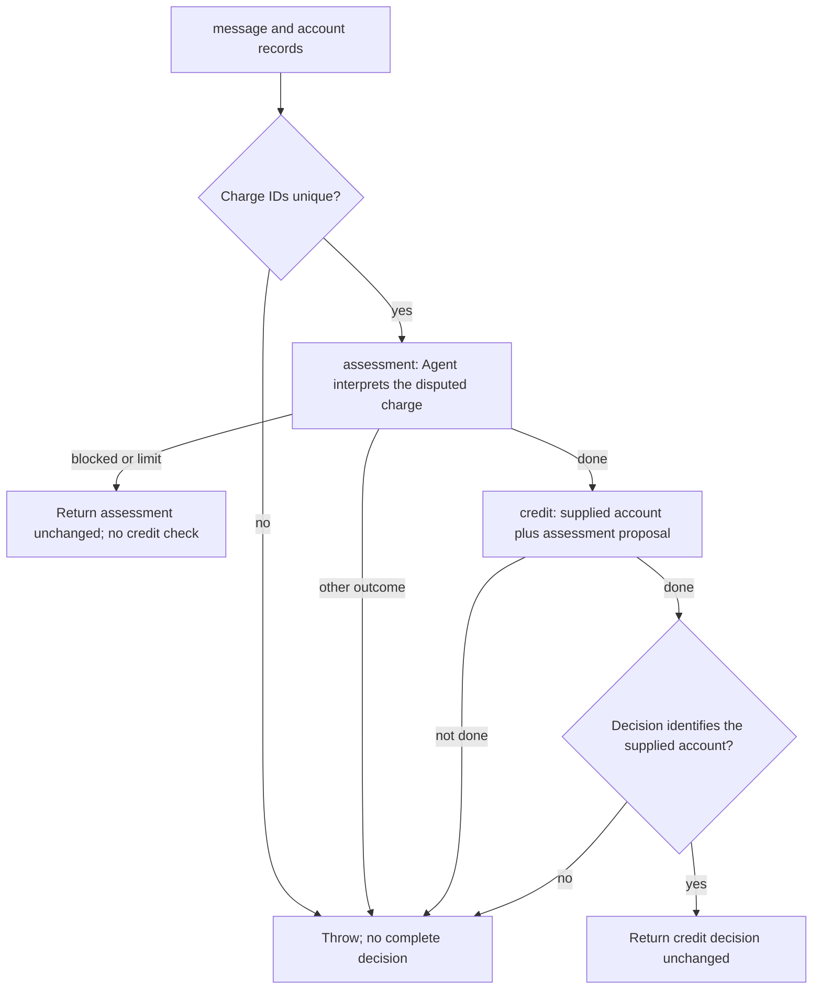

# Support case: behavior

Source interpretation, not an observed Run. Source references identify evidence, not semantic verification.

The credit Flow independently checks duplicate charge IDs, then applies local deterministic policy.
Its returned disposition can be credit_eligible, no_credit, or manual_review. Those are result fields, not Run outcomes.
The coordinator forwards the full input to assessment. Assessment's Agent instructions include the serialized full input.
The credit call receives account facts and the assessment proposal, not the original customer message as a separate field.
No credit or customer message is sent by this example.

## Source and folded behavior

- `flows/resolve/resolve.ts:18-65` owns the sequence, early returns, and account identity check.
- `flows/assess/assess.ts` owns Agent instructions and validates the proposal or refusal.
- `flows/check-credit/method.ts` owns duplicate-ID validation and the call to local policy.
- `flows/check-credit/policy.ts` owns eligibility, the credit cap, and manual-review decisions.
- Cancellation checks and reporting are folded. Cancellation can interrupt the sequence and propagates as failure.
- Full schema constraints and detailed policy branches are folded into their owning source files.
